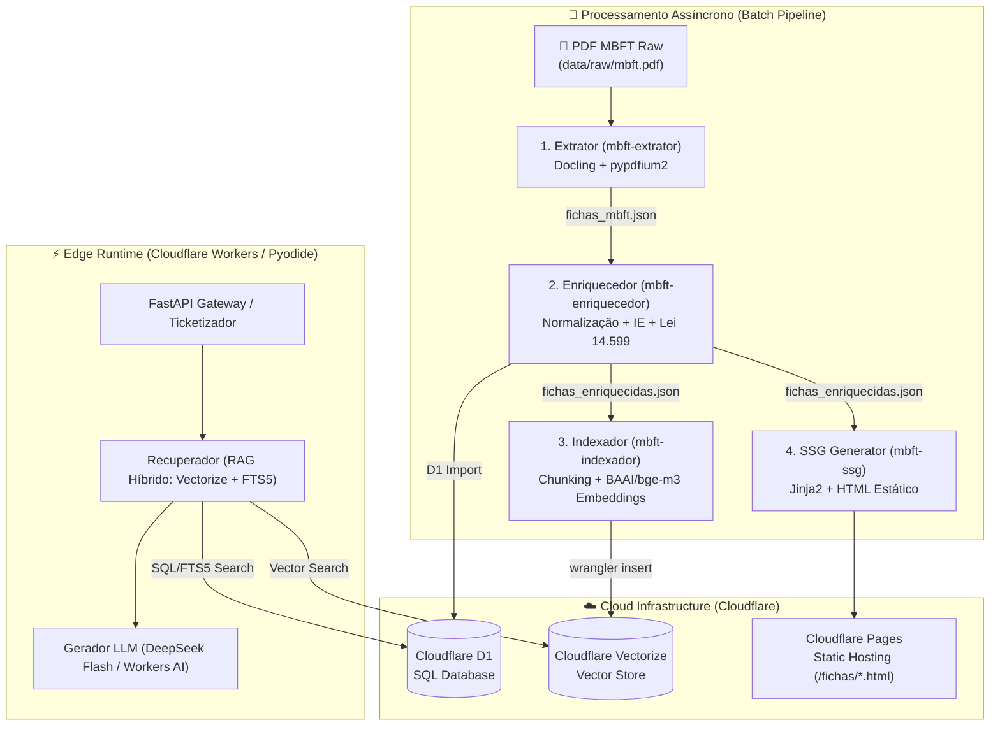

# MBFT - Manual Brasileiro de Fiscalização de Trânsito

Monorepo para processamento, extração de dados estruturados e aplicações inteligentes baseadas no Manual Brasileiro de Fiscalização de Trânsito (**MBFT** - Resolução CONTRAN nº 985/2022 e alterações posteriores).

---

## 📐 Arquitetura Geral do Sistema



---

## 🏗️ Estrutura do Repositório

- **`data/raw/`**: Documento fonte original (`mbft.pdf`).
- **`data/processed/`**: Dados finais consolidados por etapa:
  - **`extrator/`**:
    - `fichas_mbft.json`: Base estruturada contendo as 402 fichas de fiscalização com metadados, regras e conteúdo normativo.
    - `mbft_parte_geral.md`: Transcrição semântica da parte geral (páginas 1 a 31).
    - `imagens/`: Ilustrações, placas de sinalização e diagramas de trânsito em alta definição (300 DPI).
- **`pipelines/extrator/`**: Módulo em Python responsável pela ingestão, OCR, costura geométrica de colunas e serialização com aceleração CUDA.

---

## 🚀 Como Executar

Este projeto utiliza o gerenciador de pacotes **`uv`**.

### Instalação de Dependências

```bash
uv sync
```

### Execução do Extrator

A partir da raiz do monorepo, via script de console:

```bash
# Executar extração da parte geral
uv run mbft-extrator geral

# Executar extração das fichas estruturadas
uv run mbft-extrator fichas

# Executar pipeline completo
uv run mbft-extrator tudo
```

Ou diretamente através do script auxiliar:

```bash
uv run python pipelines/extrator/extrair.py tudo
```

Consulte [pipelines/extrator/README.md](file:///d:/dev/mbft%20-%20extrator/pipelines/extrator/README.md) para detalhes técnicos da arquitetura do extrator.
