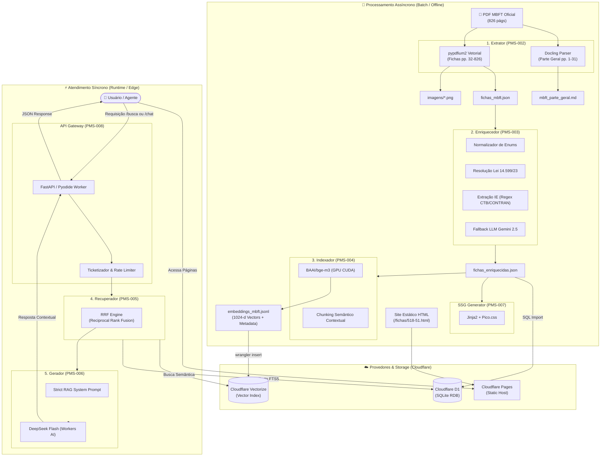

# PMS-001: Mecanismo RAG do Manual Brasileiro de Fiscalização de Trânsito

## 1. Contexto e Escopo
O Manual Brasileiro de Fiscalização de Trânsito (MBFT) é um documento oficial, aprovado por Resolução do CONTRAN (Conselho Nacional de Trânsito), destinado a *"autoridades de trânsito, seus agentes e órgãos de julgamento de 1ª e 2ª instâncias"*. [^mbft]
É disponibilizado apenas em formato PDF, tornando difícil a leitura em dispositivos com tela pequena e permitindo apenas a busca textual exata.
Este documento apresenta a visão geral do mecanismo proposto, com a descrição detalhada dos módulos sendo objeto de Propostas de Melhoria do Sistema (PMS) específicas.

[^mbft]: [Manual Brasileiro de Fiscalização de Trânsito.](https://www.gov.br/transportes/pt-br/assuntos/transito/conteudo-contran/resolucoes/mbvt20222.pdf)

---

## 2. Objetivos e Não Objetivos

* **Objetivos (Goals):**
  * Extrair o conteúdo do MBFT de maneira estruturada.
  * Permitir busca semântica por intenção e linguagem natural.
  * Gerar respostas coerentes e contextuais, estritamente limitadas às informações presentes no manual.
  * Apresentar as fichas de enquadramento em formato web responsivo.
  * Fornecer interface web simples para entrada de consultas pelo usuário.

* **Não Objetivos (Non-Goals):**
  * Não é meta aplicar jurisprudência que modifique o entendimento normativo.
  * Não é meta tipificar juridicamente casos concretos em determinados enquadramentos (a responsabilidade da subsunção do fato à norma permanece com o agente/usuário).

---

## 3. Design da Solução

### Etapas / Módulos
O mecanismo divide-se em 5 etapas funcionais, separadas entre processamento assíncrono (*batch*) e atendimento síncrono (*runtime*):

1. **Extrator** (PMS-002): recebe o arquivo PDF oficial do MBFT e retorna o texto da parte geral e uma lista em formato JSON com os campos extraídos das fichas de enquadramento, além das imagens associadas.
2. **Enriquecedor** (PMS-003): normaliza campos de dados categóricos (vocabulário controlado) e gera novos atributos estruturados com base em extração de informação (*Information Extraction*) a partir de campos de texto livre (como referências a artigos, flags de crime de trânsito e enquadramentos correlatos). Também realiza a extração de regras globais da Parte Geral para posterior uso em *prompts* (ex: validade de multas).
3. **Indexador** (PMS-004): responsável pela estratégia de *chunking* semântico, geração das representações vetoriais (*embeddings*) e por persistir os dados estruturados no banco relacional SQL e os respectivos vetores de busca no banco vetorial (Cloudflare Vectorize), mantendo a chave identificadora unificada.
4. **Recuperador** (PMS-005): recebe a busca textual do usuário, gera o seu *embedding*, consulta a base vetorial por proximidade semântica e recupera os registros correspondentes hidratados via SQL.
5. **Gerador** (PMS-006): utiliza um LLM para processar a pergunta do usuário, o contexto normativo resgatado pelo recuperador e um *prompt* orientador (com regras de ancoragem factual), devolvendo uma resposta contextualizada ao usuário.

As etapas 1, 2 e 3 são executadas apenas de forma pontual a cada atualização normativa do MBFT.
As etapas 4 e 5 são disponibilizadas para consumo contínuo por meio de uma API REST.

### Front End
Página web estática simples para interação do usuário e consumo da API do sistema.

---

## 4. Alternativas Consideradas

* **Busca Textual via FTS5 (SQLite):** Foi considerado o uso do módulo FTS5 (*Full-Text Search*) nativo do SQLite em vez de *embeddings*. No entanto, a busca puramente sintática não contempla a busca semântica por sinônimos nem a interpretação de descrições fáticas em linguagem natural. O custo computacional e de infraestrutura dos modelos modernos de *embedding* não justifica a perda de precisão e usabilidade.

---

## 5. Preocupações Transversais

* **Controle de Custos e Latência de LLM:** A geração de respostas via LLM apresenta custos e consumo de recursos sensíveis à escala, agravados por acessos automatizados de *crawlers* e *bots*. Devem ser implementados mecanismos de proteção na borda (*rate limiting* e mitigação de bots) e camadas de *cache* (exato e semântico) para reutilizar respostas de consultas frequentes sem disparar novas chamadas ao modelo.