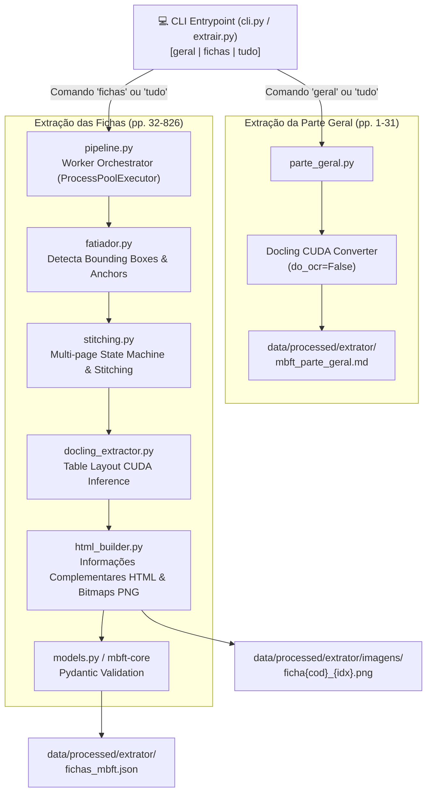

# Pipeline Extrator MBFT (`mbft-extrator`)

Módulo responsável pela extração estruturada de alta fidelidade do **Manual Brasileiro de Fiscalização de Trânsito (MBFT)** a partir do PDF oficial.

> **Nota de Arquitetura**: Este arquivo é um guia operacional e de desenvolvimento (*Developer Guide*). 
> Para a documentação completa de arquitetura, design da solução, diagramas e trade-offs, consulte o Documento de Design **PMS-002** em `docs/PMS-002 - Design do extrator.md`.
> Para o contrato de dados gerado por este pipeline, consulte o pacote **`mbft-core`** em `packages/core/README.md`.

---

## 📐 Fluxo Interno da Extração



---

## 1. Uso da Linha de Comando (CLI)

O pipeline expõe uma CLI robusta para extração pontual ou em lote. Certifique-se de executar os comandos a partir da raiz do monorepo:

```bash
# Extração da Parte Geral (páginas 1 a 31)
uv run mbft-extrator geral

# Extração de intervalo de páginas específico
uv run mbft-extrator fichas --range 32-37

# Extração completa (Parte Geral + Fichas) com exportação individual
uv run mbft-extrator tudo --salvar-individuais

# Alternativa via script atalho direto
uv run python pipelines/extrator/extrair.py tudo
```

### Utilitários de Auditoria

```bash
# Executa a comparação regressiva entre os backups antigos e a versão atual
uv run python pipelines/extrator/scripts/comparar_versoes.py
```

---

## 2. Tecnologias e Aceleração por Hardware

- **Python 3.14**: Execução gerenciada nativamente via `uv`.
- **PyTorch (CUDA 13.2)**: Aceleração GPU para inferência de modelos de layout e OCR.
- **Docling**: Extração semântica com `AcceleratorOptions(device="cuda")` com *fallback* inteligente para extração vetorial direta via `pypdfium2`.
- **ProcessPoolExecutor**: Execução paralela de extração de fichas multipáginas com múltiplos *workers* e carregamento *lazy* dos modelos de visão na GPU.

---

## 3. Estrutura do Código-Fonte (`mbft_extrator/`)

- **`cli.py`**: Ponto de entrada CLI e orquestração de workers paralelos.
- **`pipeline.py`**: Orquestrador principal da extração de uma ficha completa.
- **`models.py`**: Re-exportação de retrocompatibilidade dos contratos em `mbft-core`.
- **`parte_geral.py`**: Pipeline das páginas 1 a 31 para Markdown.
- **`fatiador.py`**: Detecção vetorial rápida e mapeamento geométrico das fichas no PDF.
- **`stitching.py`**: Algoritmo de canais de colunas e costura entre páginas consecutivas.
- **`docling_extractor.py`**: Integração com Docling e inferência CUDA.
- **`html_builder.py`**: Montador de HTML semântico em 2 colunas e exportador de bitmaps PNG.
- **`auditoria.py`**: Validador interno e gerador de sumários.
